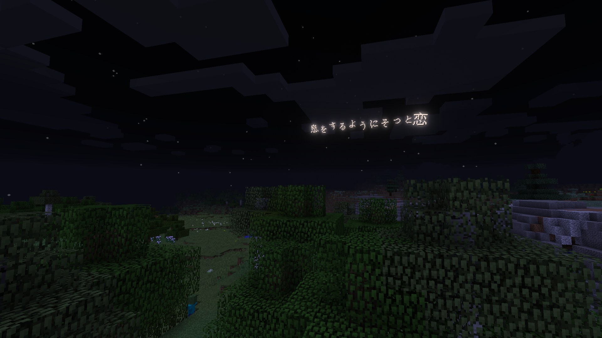
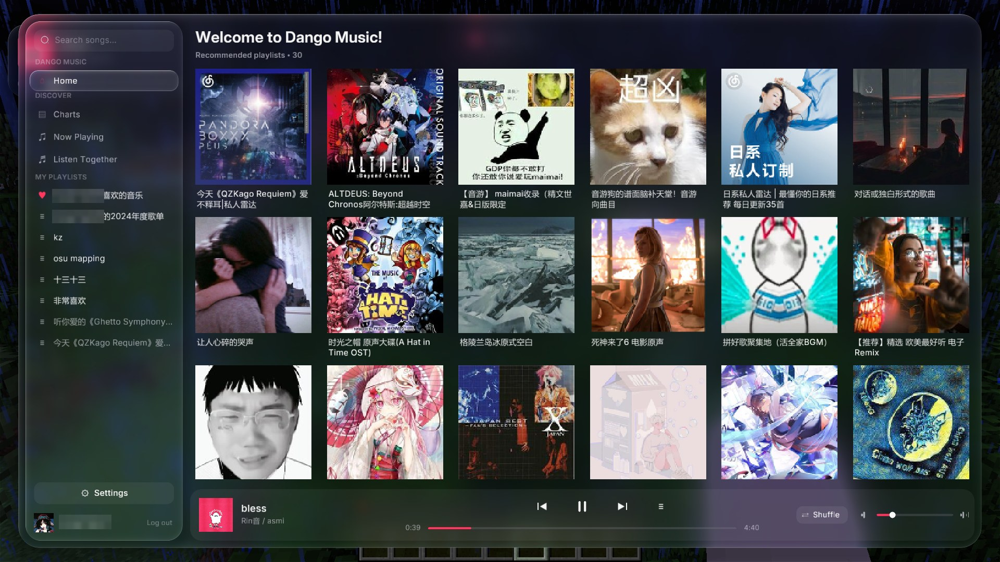
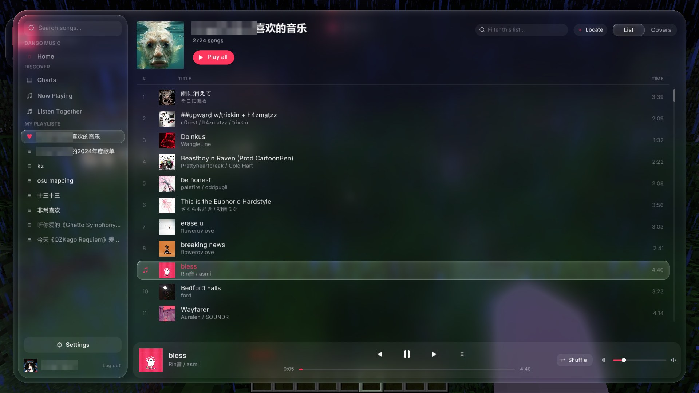
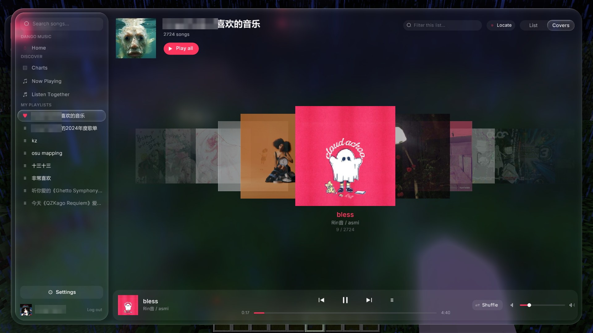
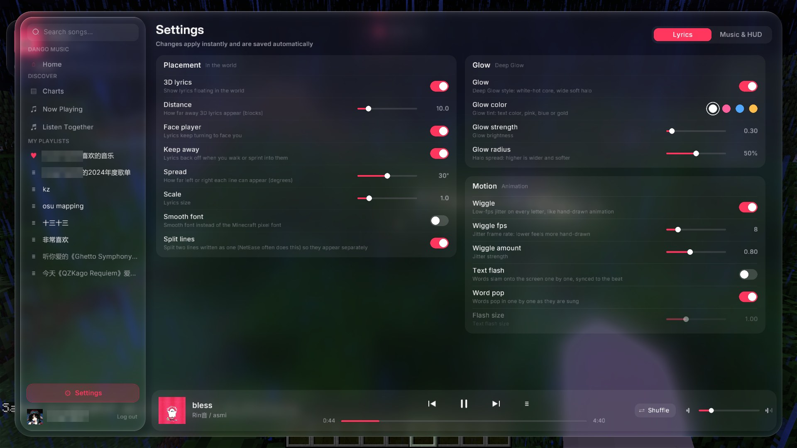
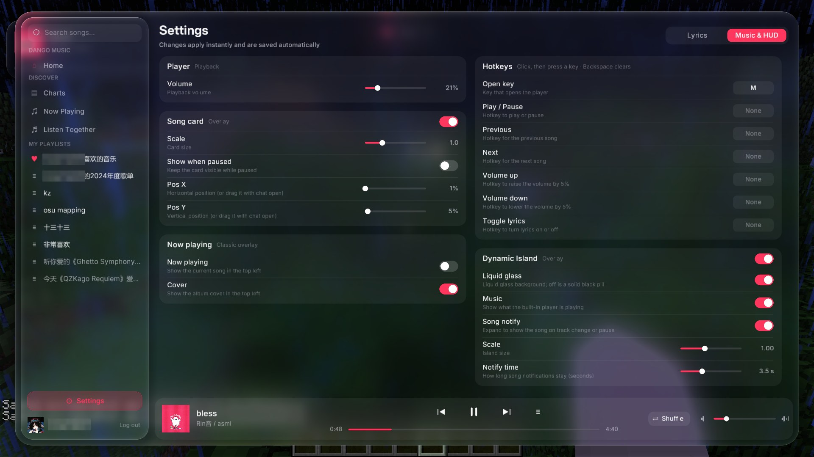

<p align="center"></p>

# Dango Music

在 Minecraft 1.8.9 里听网易云音乐的 Forge mod：液态玻璃风格的播放器、漂浮在世界里的 3D 歌词、Song card、灵动岛，还能和朋友一起听歌。

*A Forge 1.8.9 mod that brings a NetEase Cloud Music player into Minecraft — liquid-glass UI, 3D in-world lyrics, a song card HUD, a Dynamic Island and Listen Together.*

## 截图

<p align="center"></p>
<p align="center"><sub>漂浮在世界里的 3D 歌词</sub></p>

| | | |
|:---:|:---:|:---:|
|  |  |  |
| 首页 · 推荐歌单 | 歌单 · 列表视图 | 歌单 · 封面墙视图 |

| | |
|:---:|:---:|
|  |  |
| 设置 · Lyrics | 设置 · Music &amp; HUD |

## 功能

- **播放器**（默认按 `M` 打开）：每日推荐、排行榜、我的歌单、搜索；列表 / 封面墙两种视图；歌单内筛选、一键定位到正在播放；平滑滚动和切换动画
- **歌词**：网易云逐字歌词（yrc）
  - 3D 歌词漂浮在世界里，跟着演唱一句句出现，暂停时自动隐藏
  - Deep Glow 发光、Wiggle 抖动、文闪、Word pop
  - 自动拆开"两句写在一行"的歌词
- **Song card**：iOS 风格的歌曲卡片，打开聊天栏可以拖动位置
- **灵动岛**：屏幕顶部显示正在播放，切歌时展开
- **一起听歌**：开房间、分享房间码，所有人自动同步到同一首歌、同一秒（基于 Firebase）
- **设置**：都在播放器侧栏的 ⚙ 里；可以绑定快捷键（播放 / 暂停、上一首、下一首、音量、开关歌词）
- 网易云扫码登录（VIP 歌曲需要会员账号）

## 安装

1. 安装 Forge 1.8.9（11.15.1.2318）或使用支持 Forge mod 的客户端（如 Lunar）
2. 把 `DangoMusic-x.x.x+1.8.9.jar` 放进 `.minecraft/mods`
3. 进游戏按 `M`，点左下角扫码登录网易云

配置、登录凭证、缓存都存在 `.minecraft/config/dangomusic/`。

## 构建

需要 JDK 8。

```bash
build-all.bat                  # 构建所有版本，jar 都收集到 dist/
```

只构建 1.8.9：

```bash
cd legacy
gradlew build                  # 输出 legacy/build/libs/DangoMusic-x.x.x+1.8.9.jar
gradlew runClient              # 开发环境里直接运行
```

### 项目结构

```
version.properties   版本号（所有 Minecraft 版本共用）
common/core          核心：模块、设置、网易云接口、播放器、一起听歌（不依赖 Minecraft）
common/ui            界面：播放器窗口、歌词、Song card、灵动岛（只通过 Gfx / Platform 接口画）
legacy/              Forge 1.8.9 平台层：实现 Gfx / Platform，OpenGL 着色器、字体
```

`common` 不单独构建，由各平台层用 `includeBuild("../common")` 引进去，打进同一个 jar。
`common` 的依赖里没有 Minecraft，所以写错了地方（在共用代码里用了游戏的类）会直接编译不过。

### 一起听歌（Firebase）

源码里不带 Firebase 配置，不配置也能构建、能用，只是"一起听歌"会提示未配置。要启用：

1. 在 [Firebase 控制台](https://console.firebase.google.com/) 新建项目
   - Authentication → 登录方法 → 开启 **匿名**
   - 创建 **Realtime Database**
2. 把 `firebase.properties.example` 复制成 `common/core/src/main/resources/firebase.properties`，填上 `apiKey` 和 `databaseUrl`
3. 数据库规则设成下面这样：只有登录用户能读写；房间只能由房主改，别人只能改自己的成员信息；不能覆盖别人正在用的房间（房主超过 10 分钟没心跳的废弃房间除外）：

```json
{
  "rules": {
    "rooms": {
      "$code": {
        ".read": "auth != null",
        ".write": "auth != null && (!data.exists() || data.child('host').val() === auth.uid || data.child('members').child(data.child('host').val()).child('lastSeen').val() < now - 600000)",
        ".validate": "newData.child('host').val() === auth.uid || newData.child('host').val() === data.child('host').val()",
        "members": {
          "$uid": {
            ".write": "auth != null && auth.uid === $uid && root.child('rooms').child($code).exists()"
          }
        }
      }
    },
    "clock": {
      "$uid": {
        ".read": "auth != null && auth.uid == $uid",
        ".write": "auth != null && auth.uid == $uid"
      }
    }
  }
}
```

注意：只有连的是同一个 Firebase 项目的人才能一起听歌。

## 说明

- 使用的是网易云音乐的非官方接口，仅供个人学习交流；歌曲版权归各平台和版权方所有
- 海外账号需要会员才能播放大部分歌曲

## 第三方

- [Inter](https://github.com/rsms/inter)（SIL Open Font License 1.1），[Roboto Slab](https://fonts.google.com/specimen/Roboto+Slab)（Apache License 2.0）
- [JLayer](http://www.javazoom.net/javalayer/javalayer.html)（LGPL）：MP3 解码
- [ZXing](https://github.com/zxing/zxing)（Apache License 2.0）：登录二维码
- Kotlin 标准库（Apache License 2.0）

## 许可证

[GPL-3.0](LICENSE)：可以自由使用、修改和分发；分发修改后的版本时也必须以 GPL-3.0 开源。
